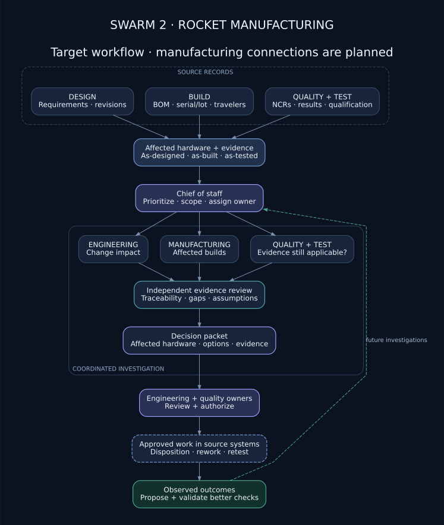

# Runtime hardening — 2026-11-14

This update follows the independent review of PR #1, merged at `15299b9`.
The earlier live receipts remain historical evidence; they do not validate this new worker protocol.

| Boundary | Enforced behavior |
|---|---|
| Generated code | Linux user, mount, PID and network namespaces; read-only input mounts; ephemeral `/tmp`; no inherited host environment. Missing isolation fails closed. |
| Model authoring | Tools and MCP servers disabled. A bounded workspace snapshot goes in; file proposals come out. Runtime checks scope, traversal, symlinks, size and fencing before applying them. |
| Verification | Explicit TAP reporter, complete nonempty plan, normal exit, no skipped/TODO tests or truncated output. An unrelated failure invalidates the suite. Ordinary assertion failures retain their criterion attribution. |
| Candidate promotion | Execution candidates may change the evaluated skill and its validators. Routing, prompts, retry policy, context and unrelated files need their own evaluator. Symlink bundles are refused. |
| Stop | Server STOP kills workers and isolated test processes, fences leases, and drains completions before closing the store. Restart the coordinator to resume. |
| Review | Decision, draft, mission, budget and outcome updates commit in one transaction. A failed update leaves the decision open for retry. |
| Outcome | `technical_success` records checks; `human_acceptance` records review. `verified_success` requires both. Older database outcomes are migrated conservatively. |
| Memory | Sources must resolve within the producing mission. Agent assertions remain suspected; procedures remain untested. Agent notes cannot impersonate human corrections. Model context cannot reuse real mission memories across missions without a future ACL design. |
| Canary | Execution/coordination retention requires completed, verified, approved missions on the candidate release, a fresh observation of those outcomes, and intact definitions. Improvement-policy canaries instead require actual policy decisions. |
| Revised requests | Changed content requires a monotonically increasing `source_revision`. Revisions cancel assigned work, invalidate derived artifacts/memory, retain the old request and return the new revision to intake. Stale delivery is ignored; withdrawn requests cannot authorize work. |
| External effects | Idempotency binds adapter, action, key and full request content. Synchronous callers serialize; committed intent is reconciled before execution or retry. Unknown effects stay unknown. |

## Operating requirements

Linux, Node 22.18+ (or Node 24), Git, `bubblewrap`, and `util-linux` (`unshare`, `prlimit`)
with unprivileged user/network namespaces permitted. No root is required. Unsupported hosts refuse
generated-code execution; there is no permission-model-only fallback. Run `npm ci`,
`npm run typecheck`, and `npm test` before use. CI covers Node 22 and 24 on Linux.

Live authoring uses the existing authenticated Claude CLI as a trusted model transport, with tools
disabled. Generated source executes only through the isolated runtime. A live author can no longer
run its own shell checks; it receives the runtime's verification feedback on a subsequent attempt.
The live improvement demo leaves qualified releases in canary until a trial and review occur.

## Remaining limits

- No real system adapters, production workload evidence, or live smoke test of the new authoring protocol.
- Acceptance requirements still need an accountable owner. A test can be complete and wrong.
- One approved synthetic trial proves lifecycle behavior, not a production success rate. Fixture
  approvals in demos are explicitly scripted and carry fixture provenance.
- The operator account and installed model CLI remain trusted. Held-out datasets remain in the repo;
  external authors with repo access can see them. Move evaluation custody outside the authoring repo
  before treating results as adversarially blind.
- Namespace/process limits are not a complete multi-tenant resource or kernel-security boundary.
  Real hostile workloads need a dedicated executor with aggregate cgroup quotas and an independent
  verification service. Generated application code can inspect tests executed alongside it.
- External adapters remain synchronous local implementations. This is not a distributed exactly-once
  protocol, and source ACLs, credential scoping and multi-coordinator leadership remain future work.
- Memory exposure plus a successful mission is an association, not proof that the memory caused success.

Local validation on Node 24.22.1: **61/61 tests**, **9/9 demos**, **75/75 demo checks**, and
TypeScript checking passed. Reproducible logs and the run summary are in `evidence/hardening/`.
No real model calls were made for this update.

Regression coverage is in `tests/hardening.test.ts`, plus the revised canary and export tests.
The diagram sources are `architecture-overview.mmd` and `architecture-overview.dot`; regenerate the
SVG with `dot -Tsvg docs/architecture-overview.dot -o docs/architecture-overview.svg`.
