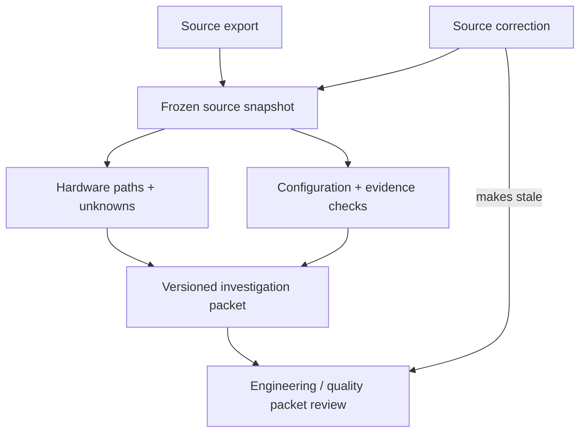

# Affected-hardware investigation pilot

Given a finding and an investigator-selected material/lot hypothesis, the runtime now traces
candidate hardware, shows the source paths, compares recorded configuration with evidence,
and produces a frozen investigation packet. It runs without model calls or network access.

This implements the research report's first vertical slice: source proving and deterministic
affected-hardware analysis. It does not implement engineering disposition, source-system
writes, physical-work verification, a BigQuery/dbt deployment, or additional agent roles.



## Try it

```sh
npm run demo:manufacturing
```

The invented case contains a lot, three known serialized components, an unresolved fourth
component identity, a removed installation, a current installation, conflicting process
revisions, qualification evidence on another serial/lot, and incomplete acceptance evidence.
It produces [a packet](../evidence/manufacturing/packet.md),
[machine-readable results](../evidence/manufacturing/packet.json), and
[a demonstration receipt](../evidence/manufacturing/summary.json).

The demonstration compares the result with a public fixture reference, records a **scripted**
packet acknowledgment, imports a correction, and verifies that the old acknowledgment becomes
historical. None of those steps constitutes a human engineering review or proof of operational value.

Use the same persistent runtime home for individual commands:

```sh
node src/cli.ts manufacturing ingest fixtures/manufacturing/anomaly/sources.json \
  --home ./var-manufacturing \
  --policy fixtures/manufacturing/anomaly/policy.json \
  --principal fixtures/manufacturing/anomaly/principal.json

node src/cli.ts manufacturing investigate fixtures/manufacturing/anomaly/request.json \
  --home ./var-manufacturing \
  --policy fixtures/manufacturing/anomaly/policy.json \
  --principal fixtures/manufacturing/anomaly/principal.json --md
```

Omit `--md` for JSON including the packet id and hash. `manufacturing packet <id>` reads a saved
packet and recalculates whether it is current. `manufacturing sources <id>` returns its original
source bundle. Both perform access checks, including current entitlements for old sources.
`manufacturing review <id> --hash <packet-hash> --outcome acknowledged --rationale "..."`
records a packet review using the same policy/principal/home flags. The other allowed outcome
is `needs_more_evidence`. There is no approve, release, hold, rework, or retest command.

## Data contract

Contracts and JSON validation live in `src/manufacturing/schema.ts`. Source exports use:

| Field | Meaning |
|---|---|
| `dataset_id`, `data_class` | Bounded investigation dataset; explicitly `synthetic` or `real`, never silently mixed |
| `source.system`, `source.type`, `source.native_id` | Exact source identity; labels and part numbers are not reconciliation keys |
| `revision` | Positive integer revision assigned by the trusted adapter; same version with different content is rejected |
| `valid_from`, `valid_to` | Half-open interval when this assertion/relationship applied; canonical UTC timestamps |
| `access_tags` | All listed entitlements are required; missing/empty tags are rejected |
| `withdrawn` | Explicit tombstone; payload must be null |
| `kind`, `payload` | Hardware, relationship, configuration assertion, finding, or evidence |

An import appends immutable source versions to the existing SQLite store. Ingestion time
(`known_from`) is assigned by the runtime; callers cannot backdate it. At a requested knowledge
time the highest source revision received by then is selected. Its knowledge interval ends when
a higher revision becomes known; an older revision delivered later never replaces it. Snapshots
pin the selected versions, their hashes, and an exact ingestion watermark, including withdrawals.
Multiple imports can share a wall-clock timestamp; the frozen watermark disambiguates an actual
saved snapshot. Timestamp-only reconstruction includes all imports known at that timestamp.

Each source object describes one assertion interval. Use separate native event identities for
multiple installation/removal intervals. An installation relationship runs from component to
parent assembly; its interval ends at removal. `produced_from`, `split_from`, and `merged_from`
run from the derived item/lot to its source lot. Their validity is the continuing genealogy
relationship, **not the duration of the manufacturing operation**. Source adapters must preserve
that distinction; this importer cannot reconstruct overwritten or missing source history.

Hardware has a stable internal id and explicit source aliases. Ambiguous aliases and duplicate
hardware identities remain unresolved. A withdrawn source identity cannot later be reassigned
to different hardware. Alias mappings in the export are operator-supplied assertions, not
automatically verified reconciliation.

The pilot's input is a normalized Consumer-layer export. The [dbt/BigQuery project](../warehouse/README.md)
now defines conformed dimensions, `sc_dim_hardware`, genealogy/identity bridges, revision-grain
facts and Consumer views. A trusted warehouse export connector is still needed to map those
curated records into this contract. Source systems keep record ownership. No warehouse schema
or operational connector has been deployed.

## What the deterministic engine establishes

- Starting from the selected lot, traverse derived lots/components, then their installed parents.
  Never fan back down from an assembly into unrelated components.
- Require a common valid-time interval along a path. Removed components remain visible when
  installed during the investigation's exposure window; disjoint installation windows do not
  create an invented simultaneous assembly.
- Include the recorded finding subject, independently of whether the selected lot hypothesis
  has been linked to it. A missing link is an explicit gap, not proof of causality.
- Keep unresolved endpoints visible as `unknown`. Stop uncertain traversal and show the gap.
  Hardware not reached is **unassessed**, never automatically unaffected.
- Record path-level source hashes. Flag invalid relationship kinds, cycles, missing identities,
  incomplete declared genealogy and traversal limits. Source correctness and universe completeness
  remain unestablished even when every traversed relationship is internally consistent.

Configuration is assessed for an explicit time, scope (designed/planned/built/installed/tested),
and requested dimensions. Source authority is field-specific and supplied in the operator policy.
Contradictory assertions remain visible even if one is from a less authoritative source. Missing
authority or disputed identity prevents a known configuration value.

Evidence is compared against the exact target configuration hash. Missing dimensions stay
missing, different configurations require judgment, expired evidence has no coverage, and
qualification cannot silently become acceptance. `full` coverage means **all requested dimensions
match**, not that the engineering claim or all relevant dimensions have been established. Even an
exact same-item match is only `candidate_for_review`; `supports_acceptance` remains false.

## Review, access and history

Packet hashes bind the request, analysis-rule version and actual analysis/review source-code hash, snapshot, source manifest, authority policy,
candidate set, configuration and evidence comparisons. Reviews require the exact hash and a
named principal with an engineering/quality review grant in the operator policy.

The full authority policy is preserved in each packet. An analysis-code change also makes saved
reviews stale; a manually maintained version label alone is insufficient.

Any newly ingested source version in the same dataset makes old packets/reviews stale, including
new records that could reveal previously unknown siblings. Policy changes also make them stale.
This deliberately conservative invalidation may require re-review for an unrelated or out-of-order
revision; narrower dependency invalidation is deferred until completeness can be established.
Old packets and reviews remain immutable and inspectable. Acknowledgment means the packet was
reviewed; it does not establish an affected/unaffected disposition or authorize physical work.

Access is checked for the entire bounded source snapshot; inaccessible rows cause a refusal,
rather than a misleading filtered genealogy. Current source tags are also checked before an old
packet or its sources can be read, so a tag change applies to previously saved outputs. A source
withdrawal is an invalidation event, not permission to erase history or bypass access checks.

**Trust boundary:** this is an operator-run local CLI. The principal and policy files are trusted
operator inputs, not an authentication system. Protect the runtime home and those files at the
OS level. A live connector/API must derive identity, source entitlements, authority grants and
revocation updates from trusted services. It must not let callers choose their own grants. No
HTTP endpoint, shared-user service, source-system ACL integration, or cross-mission memory reuse
has been enabled. Previously exported files cannot be retroactively revoked by the local runtime.
Reviews and their events are labeled `local_operator_assertion`; the CLI cannot prove that a
real person rather than a script supplied them. Synthetic review events retain that evidence class.

## Evaluation and remaining work

`compareHardware` compares candidates and required unknowns with a supplied reference set. It
reports misses and extra candidates; it cannot establish whether that reference is correct.
One regression test deliberately injects a plausible but wrong source relationship: traversal
includes it, while the separate fixture reference exposes the extra hardware. That demonstrates
the need for authoritative source review and independent ground truth.

Before operational use, obtain engineering/quality-adjudicated cases outside this repository.
Compare manual investigation, SQL/rules, one agent and any proposed swarm on the same source
snapshots. Measure missed hardware, unnecessary investigations, unknown handling, source support,
review effort and elapsed decision time. Add agents only after showing additional value.

Research implementation status:

| Recommendation | This addition |
|---|---|
| Hardware/source identity and two time axes | Implemented for normalized local exports |
| Reproducible read-only source snapshots | Implemented in the existing runtime database |
| Exact identity reconciliation and genealogy | Implemented; mappings still require source validation |
| Evidence applicability and explicit unknowns | Implemented as deterministic comparisons, never engineering acceptance |
| Exact packet review and invalidation | Implemented; local operator policy, no live authorization service |
| Manufacturing source adapters / BigQuery Consumer mart | dbt models and local fixtures implemented; real connections and deployment remain open |
| Agent investigations and independent model review | Deferred pending a measured advantage over the deterministic baseline |
| Physical completion verification | Deferred; ticket or operation completion is never represented as physical verification |
| External evaluation custody / manufacturing self-improvement | Deferred; public synthetic fixtures are not held-out operational evidence |

The supplied research artifact was `deep-research-report.md`, SHA-256
`480c53d5ec308bea0ab09f363db9f042a1d990d02a03b4cc9d98b5e71551a25c`.
Its recommendations informed this implementation; its inaccessible session citation tokens are
not treated as independently verified sources or imported into runtime policy.
