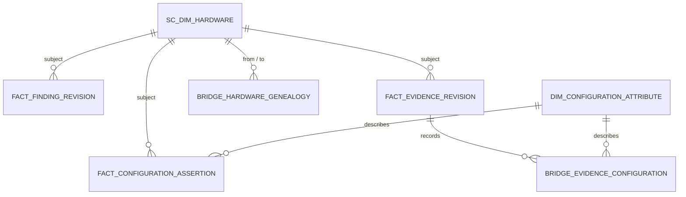

# Manufacturing Kimball models for dbt / BigQuery

The runtime's source records were an investigation contract, not a dimensional warehouse.
This project adds **Staging → Intermediate → Mart → Consumer**, with explicit grains,
conformed keys, `sc_dim_` history and `bridge_` relationships. BigQuery is the deployment target;
DuckDB is a local test adapter only. No cloud tables, credentials or permissions are provisioned.

## Findings addressed

| Modeling issue | Change |
|---|---|
| Source revisions could be counted as additional NCRs/tests | Separate revision-grain facts from one-record-per-object Consumer views |
| Hardware identity, configuration and alias relationships were mixed | Durable hardware dimension, Type 2 hardware history, identity bridge, configuration assertion fact |
| Current metadata could leak into a historical investigation | Distinct physical-validity and knowledge intervals; original fact keys resolved at the then-known sequence |
| Late corrections / out-of-order deliveries could overwrite history | Immutable source revisions, content validation, replay deduplication and monotonically advancing effective revision windows |
| A bridge join could multiply facts | Explicit bridge grains, separate facts, aggregation before evidence joins, uniqueness and fanout tests |
| Missing and ambiguous identifiers could disappear in inner joins | Unknown dimension members plus an explicit missing/ambiguous/resolved status; source references remain available |
| Wide agent tables could bypass curation | Consumer models depend only on Mart or Consumer; the verifier checks the DAG |
| Operational detail was absent from the source contract | No fabricated operations, quantities, yields, acceptance results, suppliers or structured part revisions |

## Bus matrix and grains

All identities are scoped by `dataset_id`, which must denote an intentional source/tenant boundary.
A source `system` name must identify a stable deployed system, not an arbitrary display label.
The conformed keys are shared across every fact and bridge in that scope.

| Model | Exact row grain | Conformed dimensions / role keys | Aggregation rule |
|---|---|---|---|
| `fact_finding_revision` | One accepted recorded revision of a finding | Hardware, SC Dim Hardware, Source System, Source Revision, observed/recorded Date | Revision count is not NCR count |
| `fact_configuration_assertion` | One source revision asserting one configuration attribute of hardware | Hardware, SC Dim Hardware, Source System, Source Revision, Configuration Attribute, recorded Date | Factless observation; preserve contradictory assertions |
| `fact_evidence_revision` | One accepted recorded revision of an evidence object | Hardware, SC Dim Hardware, Source System, Source Revision, Evidence Class, recorded Date | No inferred test pass/fail, measurement, or acceptance |
| `bridge_hardware_genealogy` | One source relationship revision | From/to Hardware and SC Dim Hardware; Source System / Revision | Do not infer quantities or allocation weights |
| `bridge_hardware_identity` | One hardware version / exact source identity | Hardware, SC Dim Hardware | Many identities per hardware; ambiguous matches remain multiple bridge rows |
| `bridge_evidence_configuration` | One evidence revision / configuration attribute | Evidence revision, Configuration Attribute | Aggregate at evidence grain before joining a fact |

`dim_hardware` has one durable row per enterprise hardware id. Mutable labels, hardware kind,
and genealogy completeness live in `sc_dim_hardware`. `dim_source_revision` is immutable
provenance, including withdrawals and out-of-order versions that never became current; it is
not a business-activity fact. `dim_date` is role-playing. Evidence class and configuration
attribute are shared small dimensions.

Every Mart model has an enforced dbt column/type contract. Primary-key uniqueness and foreign-key
relationships are tested. BigQuery does not enforce PK/FK constraints; this project does not
declare optimizer constraints that could be false during a load.



Hardware, Source System, Source Revision and Date joins are omitted from the small diagram.
The bus matrix and `models/mart/schema.yml` specify the complete contracts.

## Two clocks and late-arriving data

`valid_from` / `valid_to` describe the physical assertion interval. `known_from` / `known_to`
describe recorded knowledge. Knowledge sequence is the authoritative tie-breaker when two
imports share a timestamp. All intervals are half-open. The latest **higher source revision**
closes the preceding knowledge interval, including when the new revision is a withdrawal.
A lower revision delivered later is kept in provenance with a zero-length effective knowledge
interval and never becomes the current business fact or dimension member.

`sc_dim_hardware` is Type 2 on knowledge changes, with physical-validity fields retained
separately. An earlier finding receives the hardware-version key known when that finding
revision arrived, constrained by its physical reference time. Those original fact keys are not
rewritten when a late dimension arrives. Consumer views expose separate
`investigation_*` keys resolved at the requested knowledge cutoff. This makes both viewpoints
explicit rather than silently mixing them.

Aliases are resolved exactly. If multiple hardware versions match an alias at a knowledge
point, the resolution is ambiguous and the fact gets `__unknown__` keys. The alias and status
are retained. If two canonical source objects claim the same enterprise hardware identity,
the build fails the ownership test; it does not choose one arbitrarily.

The input already contains immutable revision history, so it is not wrapped in another dbt
snapshot. A future mutable upstream source may need dbt snapshots or CDC before this boundary.
Neither periodic snapshots nor this project can reconstruct source states never captured.

## Consumer layer and measures

The Consumer models are a **single declared investigation slice**, not a dynamic authorization
API. Set `consumer_dataset_id`, `consumer_valid_at`, and optionally `consumer_known_sequence`.
Omitting the sequence chooses the latest captured canonical source sequence in that dataset.
An empty dataset or a sequence beyond captured history fails a data test.

- `consumer_findings`: one current-at-cutoff finding object, with original and investigation-time hardware keys.
- `consumer_hardware_as_of`: hardware attributes known at that cutoff, retaining physical intervals.
- `consumer_genealogy`: relationship revisions known at that cutoff, retaining removed installations and valid-time intervals. It is not automatically today's BOM.
- `consumer_configuration_assertions`: assertions applicable at the physical time; conflicting values stay separate.
- `consumer_configuration_conflicts`: contradictory values grouped across aliases that resolve to the same hardware.
- `consumer_evidence`: one evidence revision per object, with a pivot of the recorded configuration attributes. No row establishes acceptance.

For a semantic model, a finding count is a distinct count of `source_object_key` in the declared
Consumer slice. It is not a sum of revision rows, and it is not an *open* NCR count: the source
contract has no authoritative open/closed status. Evidence counts likewise count objects at
the selected knowledge point. Do not join facts together through raw genealogy and sum them.
Use explicit dimensional relationships or drill across independently aggregated facts.
The evidence pivot uses one tested bridge row per attribute; it is not a rule for choosing among
conflicting assertions.

Keep reports behind the semantic model over the Mart/approved Consumer layer. Agent access
belongs on approved Consumer shapes. None of the project SQL grants analyst access to Staging
or Intermediate. Actual IAM enforcement remains a deployment responsibility.

## What is still missing from the dimensional model

| Future business process | Required upstream fields before implementation | Intended pattern |
|---|---|---|
| Manufacturing operation execution | Execution id, work order, operation, resource, actual start/end, quantity and unit | Transaction fact; optional accumulating snapshot for lifecycle milestones |
| Inspection/test execution | Execution id, test/procedure revision, setup/configuration, measured value/unit, authoritative result | Execution/measurement facts at separate grains |
| Part/process revision management | Stable part/spec ids and revisions, effectivity, authoritative approval | Conformed part-revision and process-revision dimensions plus effectivity bridges |
| Material/supplier genealogy | Stable supplier/material/batch ids, split/merge quantities and units | Conformed supplier/material dimensions and quantity-aware bridges |
| WIP / readiness trends | Defined observation cadence and authoritative status basis | Periodic snapshot fact; no extrapolation from sparse source changes |

Do not parse a free-text value such as `SYN-PS-12 Rev C` into a supposed enterprise revision
dimension and declare it authoritative. Structured upstream identities are the next contract change.

## Run the local checks

From the repository root, in an isolated Python environment:

```sh
python -m venv .venv-dbt
. .venv-dbt/bin/activate
pip install -r warehouse/requirements-dev.txt
python warehouse/scripts/verify.py
```

Node 22.18+ is also needed to generate fixtures using the existing runtime's canonical hashing.
The verifier builds all models and contracts with DuckDB, executes data tests, reconstructs a
historical Consumer slice, and deliberately injects invalid revisions, payload bytes and SCD
overlaps to prove the corresponding checks fail. It then restores the data and runs the tests again.

For BigQuery it runs **dbt parse** in both fixture and production-source modes. A separate pure
Jinja render and SQLGlot BigQuery syntax parse checks the SELECT SQL for every model without
creating a cloud client. This is not dbt BigQuery compilation or live execution. Results and
logs are saved under [`evidence/warehouse`](../evidence/warehouse/validation.json).

An attempted cloud compilation during development was stopped when the adapter tried to
discover instance credentials. The verifier deliberately does not use cloud compilation.
Local tests cannot establish BigQuery DDL correctness, IAM, partition pruning, performance,
or operational manufacturing correctness. Those require a credentialed development project.

## BigQuery setup and release boundary

1. Copy `profiles.yml.example` to your own profiles directory; set `SWARM_DBT_PROJECT`,
   `SWARM_DBT_DATASET` and `SWARM_DBT_LOCATION` to an authorized development environment.
2. Supply `raw_project` and `raw_dataset`. The source table is `source_versions`, with
   `dataset_id`, `data_class`, `ingestion_sequence` (INT64), `known_from_text`, `record_hash`,
   and `record_json` (STRING). `record_json` is canonical JSON using the runtime convention;
   `record_hash` must be its SHA-256. The importer must capture all deliveries with stable,
   ordered knowledge sequence and UTC timestamps. See the synthetic seed for exact shape.
3. Set the Consumer scope explicitly and run `dbt build` with fixture mode **false**.
   Real sources cannot fall back to fixture seeds; the source and seed modes are mutually exclusive.
4. Build into a fresh, isolated schema prefix; dbt's standard schema naming keeps
   `<prefix>_staging`, `<prefix>_intermediate`, `<prefix>_mart`, `<prefix>_consumer` separate.
   Only release a consistent, tested set of tables/views. A multi-model dbt build is not an
   atomic publication of an investigation snapshot.

Facts, the genealogy bridge and provenance versions are partitioned by knowledge timestamp
and clustered by dataset/source identity on BigQuery. The initial models rebuild complete
history. An incremental optimization must recompute impacted identities across their full
history; a short event-date lookback would miss late corrections. There is no claim of
production-volume performance from these small fixtures.

Access tags are preserved as provenance **metadata, not authorization**. Before loading real
data, implement appropriate dataset IAM, protected views/row policies and a trusted export
service. Avoid producing an apparently complete genealogy by silently hiding inaccessible
rows. A dataset filter alone does not enforce per-user source permissions. The runtime's
local packet policy does not automatically become BigQuery IAM.

The warehouse is not yet wired to an authenticated export connector. The intended seam is a
consistent, version-pinned Consumer export into the runtime's source-snapshot importer. It must
preserve exact source revisions, hashes, entitlements, withdrawals and knowledge cutoff.

## Design references

- [Kimball: declare the grain](https://www.kimballgroup.com/data-warehouse-business-intelligence-resources/kimball-techniques/dimensional-modeling-techniques/grain/)
- [Kimball: Type 2 history](https://www.kimballgroup.com/data-warehouse-business-intelligence-resources/kimball-techniques/dimensional-modeling-techniques/type-2/)
- [Kimball: multivalued bridges and time validity](https://www.kimballgroup.com/data-warehouse-business-intelligence-resources/kimball-techniques/dimensional-modeling-techniques/multivalued-dimension-bridge-table/)
- [dbt BigQuery partitioning and clustering](https://docs.getdbt.com/reference/resource-configs/bigquery-configs)
- [dbt snapshots over mutable sources](https://docs.getdbt.com/docs/build/snapshots)
- [dbt parse versus compile](https://docs.getdbt.com/reference/commands/compile)
- [BigQuery key constraints are not enforced](https://docs.cloud.google.com/bigquery/docs/primary-foreign-keys)
